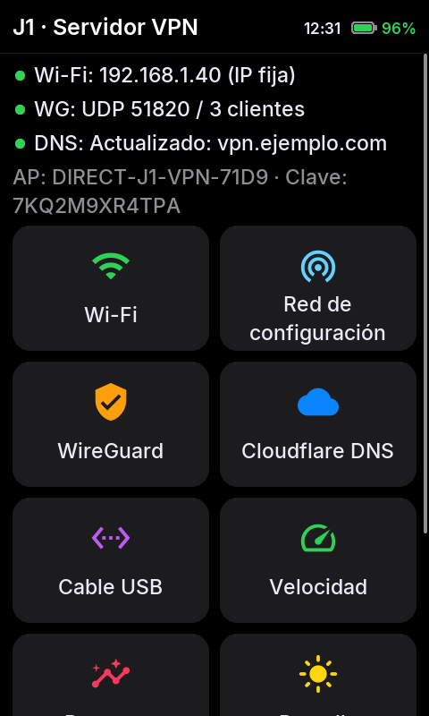
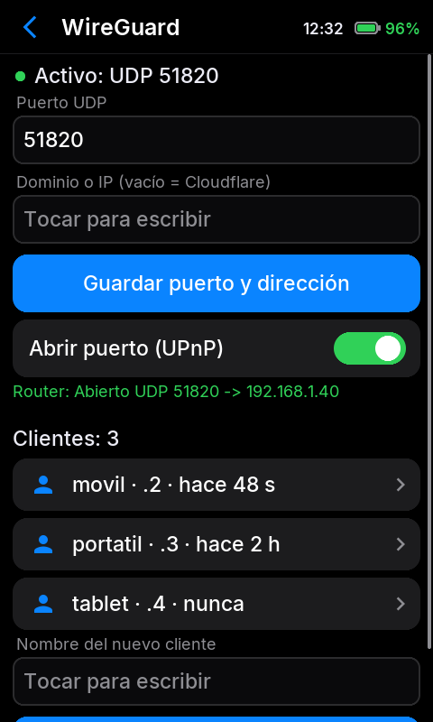

# J1 Open VPN (English summary)

**Turns a Samsung Galaxy J1 (SM-J100H) into a standalone WireGuard VPN server with a touchscreen control panel.**

"Open" stands for open source: this project uses **WireGuard**, not OpenVPN.

## Why

RAM prices are sky-high, so even a small home server costs more and more. Meanwhile drawers are full of old phones with a CPU, RAM, Wi-Fi, a touchscreen and a **battery that works as a UPS**. The 2015 Galaxy J1 (2× Cortex-A7, 512 MB RAM) is useless as a phone today but more than enough for a home VPN server. This project replaces Android with a minimal Alpine Linux dedicated to that job.

## Features

- WireGuard **in the kernel** (ARM/NEON crypto); clients created on the phone screen and imported with a **QR code**.
- Joins a Wi-Fi network by **reading its QR code with the J1's rear or front camera**: no typing the password. Full screen camera with autofocus, automatic or manual brightness, metering, contrast and sharpness.
- Touchscreen UI (C, framebuffer, antialiased Inter font, colored icons, tile home screen, zero CPU when the screen is off): status, Wi-Fi, VPN clients, logs, resources, battery (time left without the charger), brightness, lock screen (slide to unlock, optional PIN, can be turned off), speed test, power menu.
- Optional web panel over the phone's own Wi-Fi network or USB, with optional HTTPS.
- **Phone notifications** (ntfy): power cut, low battery, VPN errors, public IP change, clients connecting; on ntfy.sh or on your own locked server with an access token (guide in Spanish: docs/ntfy-propio.md, script: tools/ntfy-servidor.sh).
- **Encrypted backup** of the configuration and restore from the web panel.
- **Updates from GitHub** checked with SHA-256, no reinstall.
- **Paused VPN clients** without deleting them, with their last connection and traffic.
- **Battery:** real use in mA/W, time left and a charge limit (50-95 %).
- **USB Ethernet via OTG** (RTL8153 tested): the phone powers the adapter; cable first, **Wi-Fi as standby on the same IP** (single port forward).
- Automatic port forwarding (UPnP) and Cloudflare dynamic DNS (optional).
- Measured: ~57 Mbit/s down / ~43 up over cable; ~30 over Wi-Fi (2.4 GHz).

<table><tr><td align="center"><br><sub>Home</sub></td><td align="center"><br><sub>WireGuard</sub></td><td align="center"><br><sub>QR for the app</sub></td></tr></table>

## Install (short version)

1. Only for the **SM-J100H** (j13g). Other J1 models use different hardware.
2. Download `j1-open-vpn-boot.img` and `j1-open-vpn-rootfs.tar.gz` from [Releases](https://github.com/Farwebsite/j1-open-vpn/releases).
3. Download mode (**Vol Down + Home + Power**, then **Vol Up**), then with [Heimdall 1.4.2](https://github.com/amo13/Heimdall/releases/tag/v1.4.2) (WinUSB driver via Zadig on Windows):
   ```
   heimdall flash --KERNEL j1-open-vpn-boot.img --HIDDEN j1-open-vpn-rootfs.tar.gz
   ```
   (Odin alternative: `j1-open-vpn-odin.tar` in the AP slot; untested.)
4. First boot: black screen for about 30 seconds while it installs itself. The screen then shows the setup network `DIRECT-J1-VPN-XXXX` and its password (also the web password, user `admin`).
5. On the screen: Wi-Fi → scan → join your network. WireGuard → create a client → Show QR → scan it with the WireGuard app. Forward **UDP 51820** to the phone, or let UPnP do it.

Android stops booting, but your Android data is not erased. Flash the stock firmware with Odin to go back. The Wi-Fi firmware and MAC address belong to Samsung, so they are not shipped: they are copied from the phone's own partitions on first boot.

Full guide (Spanish): [docs/instalacion.md](docs/instalacion.md). Build from source: [docs/compilar.md](docs/compilar.md) (`sudo ./build.sh` on Linux/WSL2 with `qemu-user-static`).

License: GPL-2.0 (screen font: Inter, SIL OFL 1.1; icons: Material Icons, Apache 2.0, see `rootfs/display/fonts/`). No warranty: flashing can brick your phone.

© 2026 Farweb
