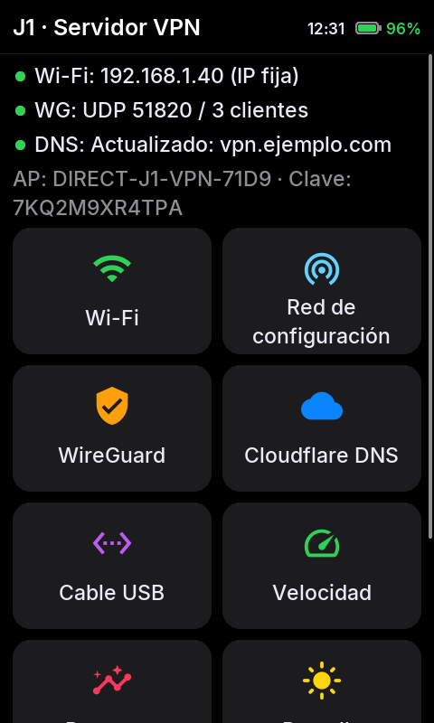
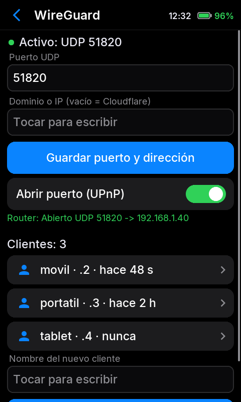
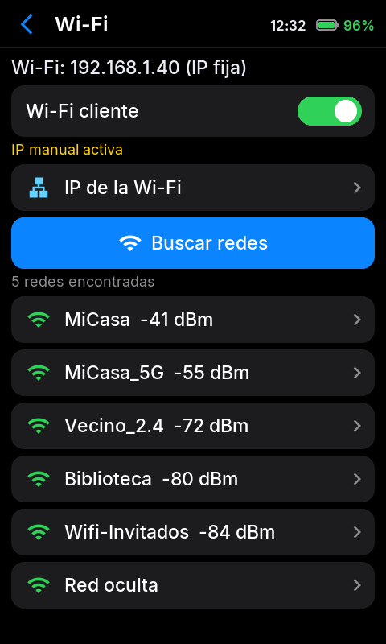
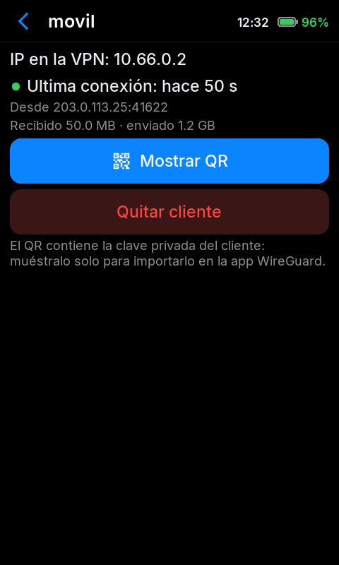
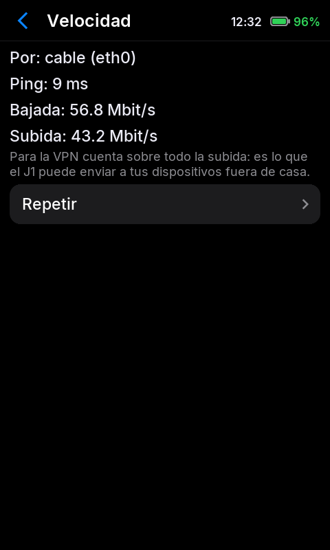
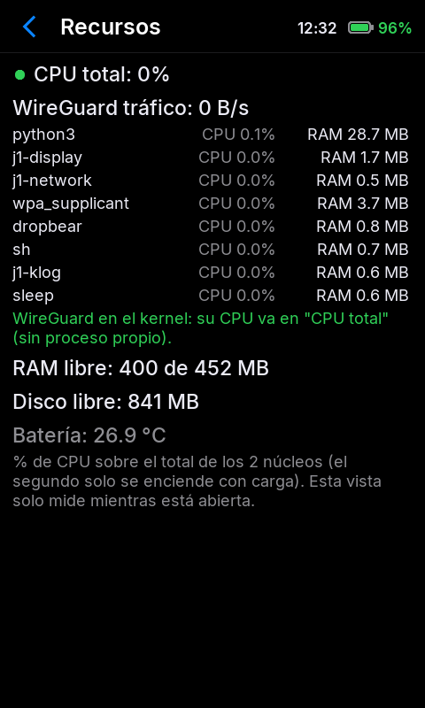
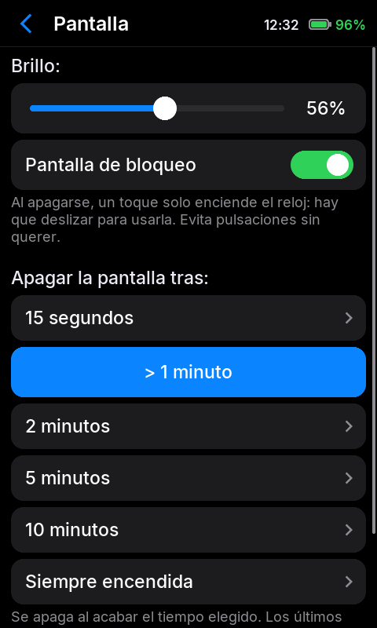
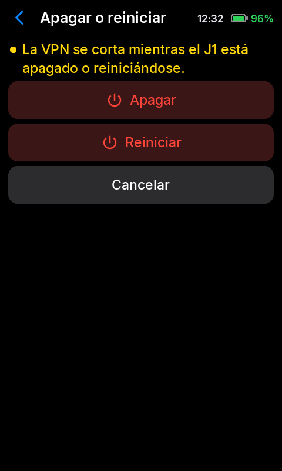

# J1 Open VPN

**Convierte un Samsung Galaxy J1 (SM-J100H) en un servidor VPN WireGuard autónomo, con pantalla táctil y consumo mínimo.**

*[English summary](README.en.md)*

> **Nota sobre el nombre:** "Open" es de *abierto*: código abierto y para todos. El proyecto usa **WireGuard**, no OpenVPN.

## Por qué existe

Con los precios altísimos que tiene la memoria RAM, montar un pequeño servidor en casa (una mini PC, una Raspberry Pi…) cuesta cada vez más. Mientras tanto, en los cajones hay millones de móviles viejos con procesador, RAM, Wi-Fi, pantalla táctil y **batería que hace de SAI** (si se va la luz, sigue funcionando).

El Galaxy J1 de 2015 (2 núcleos a 1,2 GHz, 512 MB de RAM) no sirve ya como móvil, pero es de sobra para lo que hace un servidor VPN doméstico. Este proyecto le quita Android y le pone un Linux mínimo dedicado solo a eso.

## Qué hace

- **Servidor VPN WireGuard** dentro del kernel (cifrado optimizado para ARM), para conectarte a tu casa desde fuera de forma segura.
- **Pantalla táctil de control:** estado, Wi-Fi, clientes VPN con **código QR** para importarlos en la app de WireGuard, registros, recursos, brillo, apagado…
- **Panel web** (opcional) desde el propio Wi-Fi del J1 o por USB.
- **Cable de red por USB (OTG):** con un adaptador USB‑Ethernet el J1 lo alimenta solo; el cable tiene prioridad y el **Wi-Fi queda de reserva** con la misma IP (un solo puerto abierto en el router).
- **Apertura automática del puerto** en el router (UPnP) y **DNS dinámico** con Cloudflare (opcional).
- **Red Wi-Fi propia de configuración** (`DIRECT-J1-VPN-XXXX`) para configurarlo sin cables.
- **SSH por USB opcional** (solo con clave), activable desde el panel web.
- **Pantalla de bloqueo** desactivable: con la pantalla apagada, una mano encima no pulsa nada; hay que deslizar para usarla.
- **Zona horaria** seleccionable desde la pantalla o la web (España, Canarias, Latinoamérica, EE. UU.…).
- Consumo de CPU nulo en reposo: la pantalla no gasta nada cuando está apagada.

Medido en el dispositivo de desarrollo: **~57 Mbit/s de bajada y ~43 de subida por cable**, ~30 Mbit/s por Wi-Fi (2,4 GHz).

## Capturas

Capturas reales de la pantalla del J1 (480×800), con datos de ejemplo.

<table>
<tr><td align="center"><br><sub>Inicio</sub></td><td align="center"><br><sub>WireGuard</sub></td><td align="center"><br><sub>QR para la app</sub></td></tr>
<tr><td align="center"><br><sub>Wi-Fi</sub></td><td align="center"><br><sub>Cliente VPN</sub></td><td align="center"><br><sub>Prueba de velocidad</sub></td></tr>
<tr><td align="center"><br><sub>Recursos</sub></td><td align="center"><br><sub>Brillo, bloqueo y apagado</sub></td><td align="center"><br><sub>Botón de encendido mantenido</sub></td></tr>
</table>

## Requisitos

| | |
|---|---|
| Teléfono | **Samsung Galaxy J1 SM-J100H** (j13g, Spreadtrum SC7727S, 3G). Otros modelos de J1 (J100F, J100M, J100FN…) tienen otro hardware y **no son compatibles**. |
| PC | Windows (guía principal), o Linux. |
| Cable | USB de datos. |
| Opcional | Adaptador USB‑Ethernet (probado: **RTL8153**; también CDC Ethernet, RTL8152 y ASIX) con adaptador OTG micro‑USB. |
| Red | Router con el puerto UDP redirigido al J1 (o UPnP). **No funciona detrás de CG‑NAT** sin IP pública. |

## Instalación

Guía paso a paso: **[docs/instalacion.md](docs/instalacion.md)**

En resumen: descargas `j1-open-vpn-<versión>.zip` de [Releases](https://github.com/Farwebsite/j1-open-vpn/releases), ejecutas el instalador (`instalar-windows.bat` o `instalar-linux.sh`) y pones el teléfono en modo Download. El instalador comprueba los archivos, descarga Heimdall y escribe dos particiones (`KERNEL` y `HIDDEN`). En el primer arranque el J1 se instala solo (unos 30 s) y muestra en pantalla el nombre y la clave de su red de configuración.

Android deja de arrancar (tus datos de Android no se borran). Se puede volver a Android flasheando el firmware original: [docs/recuperacion.md](docs/recuperacion.md).

## Documentación

- [Instalación](docs/instalacion.md)
- [Uso: pantalla, VPN, router, cable](docs/uso.md)
- [Volver a Android y solución de problemas](docs/recuperacion.md)
- [Compilar desde el código fuente](docs/compilar.md)
- [Notas técnicas del hardware](docs/hardware.md)

## Estructura

```
kernel/    Kernel 3.10 con USB host (OTG), Ethernet USB y WireGuard
boot/      Imagen de arranque: initramfs instalador + árbol de dispositivo
rootfs/    Sistema Alpine Linux: paquetes, programas J1, pantalla táctil (C)
install/   Instaladores para Windows y Linux (Heimdall)
tests/     Pruebas del panel (python3 -m unittest discover -s tests)
tools/     Herramientas de desarrollo (simulador de toques, capturas)
build.sh   Compila todo
```

## Licencia y créditos

GPL-2.0 ([LICENSE](LICENSE)). Usa: [Alpine Linux](https://alpinelinux.org), [WireGuard](https://www.wireguard.com) ([wireguard-linux-compat](https://github.com/WireGuard/wireguard-linux-compat)), el kernel j13g de [jnkcode](https://github.com/jnkcode/android_kernel_samsung_j13g) (LineageOS), [Heimdall](https://github.com/Benjamin-Dobell/Heimdall). La pantalla usa la tipografía [Inter](https://rsms.me/inter/) (SIL OFL 1.1) y los iconos [Material Icons](https://github.com/google/material-design-icons) (Apache 2.0); sus licencias están en `rootfs/display/fonts/`.

El firmware Wi-Fi y la MAC son de Samsung y **no se incluyen**: el J1 los copia de su propio Android en el primer arranque.

## Estado de las pruebas

- Instalación desde cero probada en un SM-J100H real: imagen de arranque en `KERNEL` y sistema en `HIDDEN`, autoinstalación (12 s), generación de clave y red, copia del firmware Wi-Fi y la MAC, búsqueda de redes, creación de clientes con QR y segundo arranque.
- En esa prueba las particiones se escribieron desde el propio teléfono (`dd`), con el mismo contenido que escribe Heimdall. Heimdall se ha usado en el desarrollo para la partición `KERNEL`. **Odin no se ha probado.**
- Uso continuado (VPN, cable con Wi-Fi de reserva, pantalla) probado durante el desarrollo en el mismo teléfono.

**Sin garantía.** Flashear particiones puede dejar el teléfono inservible si algo sale mal. Hazlo bajo tu responsabilidad y lee la guía entera antes de empezar.

© 2026 Farweb
